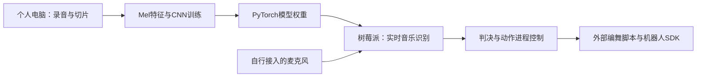

# On-device music recognition for a dancing robot

[中文说明](#中文说明)

A TonyPi bipedal robot listens through a microphone connected to a Raspberry Pi 5 and selects a dance routine for one of five songs. I built the audio classifier and the software that turns its predictions into motion commands. My teammates choreographed the dances. Our team earned first prize (third place) at the 2025 Chinese Robot Skills Competition.

## From microphone input to a dance routine

I prepared clips from song and background recordings, computed log-Mel spectrograms, and trained a six-class convolutional neural network in PyTorch on a PC. The sixth class represents ambient noise, so the classifier can identify input outside the five target songs.

On the Pi, overlapping audio windows yield successive predictions. The decision logic smooths the scores and waits for repeated evidence before selecting a song. I integrated the classifier with the dance scripts and handled interruption and return to a neutral pose through the vendor SDK. The competition configuration locks a selection for 45 seconds to keep the routine stable; this also delays responses to a change of song during that interval.

| Follow the implementation | What to look for |
| --- | --- |
| [Clip preparation](training/prepare_data.py) and [training](training/train.py) | Source-recording groups, audio augmentation, model architecture and training loop |
| [Microphone inference](inference/listen.py) | Audio capture, feature extraction, score smoothing and song decisions |
| [Robot controller](robot/music_control.py) | Mapping a decision to an external routine and managing its process |
| [Competition checkpoint](models/music_classifier.pt) and [checksum](models/SHA256SUMS) | The saved parameters used by the inference examples |

## Try it on a computer

From the repository root, use a Python environment with a working microphone, PortAudio and a compatible PyTorch installation. The following command starts the **audio-only preview** and prints recognition decisions. It can run independently of the robot.

```bash
python -m pip install -r requirements.txt
python inference/listen.py --ckpt models/music_classifier.pt
```

The target song labels are `renshi`, `dream`, `aoteman`, `amigo` and `wuren`; the background label is `noises`. For training on your own recordings or connecting the Pi to a TonyPi, see the [deployment guide (Chinese)](docs/deployment.md). Robot motion requires the vendor's SDK and the team's external choreography scripts and action library.

## Tests and interpretation

Run the [four hardware-independent tests](tests/test_portfolio.py) from the repository root. They check source-recording separation and training-only noise selection, the saved model checksum, and how the controller handles present or missing dance scripts. UTF-8 mode also supports the controller's console output on Windows.

```bash
python -X utf8 -m unittest discover -s tests -v
```

This release was assembled from competition materials. During preparation I found that the original augmentation pipeline could draw background noise from any split. The published training code limits noise sampling to the training split; the supplied checkpoint predates that correction. Measuring generalization would require retraining and evaluating on independent recordings. The tests above cover software logic; an end-to-end run of this release on the robot and measurements of accuracy and response time are outstanding.

[Engineering notes (Chinese)](docs/engineering-notes.md) · [Team contributions and third-party components](THIRD_PARTY.md)

## 中文说明

### 机器人音乐识别与动作控制

基于树莓派5与TonyPi平台的比赛项目，通过自行接入的麦克风采集音频，完成音乐类别识别与机器人动作调用。**模型在个人电脑上训练，树莓派运行推理与控制程序。** 本仓库由比赛材料整理，保留可解释的核心实现，并标明硬件与队友模块的边界。

## 我的工作

- 模型训练：组织歌曲与噪声数据、音频切片、特征处理、卷积分类网络训练与调参。
- 音乐识别：流式音频采集、对数Mel频谱、推理结果平滑、歌曲判决和动作触发。
- 机器人调试：模型部署、音频设备配置、SDK调用、动作进程中断与归中、启动环境排查。

舞蹈编排由队友完成。本仓库展示识别到编舞脚本的调用接口，不包含队友的编舞脚本及动作库。机器人底层SDK来自厂商，未声称独立实现底层驱动。

## 系统流程



音乐分类包括五首目标曲目 `renshi / dream / aoteman / amigo / wuren` 和 `noises` 噪声类。模型输入为对数Mel频谱，网络由多级卷积块与分类头组成；源码沿用历史类名SmallResNet，但不将其称为标准残差网络。

## 目录

| 路径 | 用途 |
| --- | --- |
| `training/prepare_data.py` | 在个人电脑生成多窗口切片与索引 |
| `training/train.py` | 在个人电脑训练六分类模型 |
| `inference/listen.py` | 麦克风实时识别，只打印结果，不控制机器人 |
| `robot/music_control.py` | 树莓派音乐识别及外部编舞脚本调用 |
| `models/music_classifier.pt` | 比赛材料中已有的模型，未因本次整理而重新训练 |
| `docs/deployment.md` | 数据、运行命令和机器人外部依赖 |
| `docs/engineering-notes.md` | 调试经验、整理修改及验证边界 |
| `THIRD_PARTY.md` | 模块来源与贡献说明 |

个人电脑上的原始训练工程为 `music_dance` 和 `music-dance` 两个目录。前者含本仓库采用的PyTorch训练主线；后者保留早期特征处理与训练实验，作为迭代历史，没有混入最终默认依赖。

## 开始使用

先在个人电脑创建独立Python环境，再安装依赖。`requirements.txt` 是按导入整理的依赖清单，不是已验证的跨平台环境锁定文件。

```bash
python -m pip install -r requirements.txt
python inference/listen.py --ckpt models/music_classifier.pt
```

实时识别需要可用麦克风及PortAudio支持。没有音频设备时，可以先阅读训练代码和运行不依赖硬件的回归检查：

```bash
python -m unittest discover -s tests -v
```

准备数据、重新训练、麦克风配置与树莓派部署见 [部署说明](docs/deployment.md)。

## 当前验证状态

此版本是经过整理的比赛代码展示版，完成Python语法检查及针对数据划分、噪声增强与编舞进程接口的局部回归测试，尚未在机器人上完成整理后的端到端复测。

未附公开训练集、队友动作库、厂商SDK或演示录像。没有公布未经复核的准确率、延迟或噪声鲁棒性指标。`decision_sec`是判决参数，不是实测响应时间；默认45秒歌曲锁定会影响停止与切歌响应，详见工程说明。

**训练整理修正：** 原版背景噪声增强从全部样本取材，展示版改为只使用训练集噪声。随附权重仍是修正前已有模型，因此不能据此宣称该权重的评估已消除相关数据泄漏风险。
